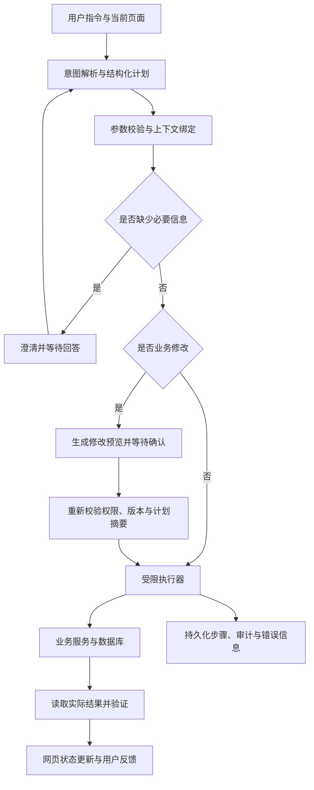

# Research LLM4Web：自然语言驱动的 Web 业务操作助手

> 创建日期：2026-10-26  
> 文档性质：从 0 到 1 的实施与实验方案，尚未完成系统开发或取得实验结果。  
> 默认条件：个人开发，已有基础 Python 能力；每周约 15–20 小时，核心版本预计 8–10 周。时间是规划估计，不是完成保证。  
> 求职定位：大模型应用算法 / AI 应用研发；通过数据、评测、执行可靠性和针对性模型优化体现技术深度。

## 1. 项目要解决什么问题

用户知道自己想完成的业务任务，但不愿逐个学习菜单、筛选器、表单和导出流程。本项目让用户通过自然语言完成订单管理操作，并在网页中看到真实、可核验的结果。

**主问题：自然语言助手能否在保持操作正确性的前提下，降低用户完成多步骤后台任务所需的时间和交互成本？**

示例任务：

1. 用户：“找出上周已付款但未发货的上海订单，按金额从高到低展示。”
2. 系统：更新网页筛选条件、排序和表格，展示数量与统计口径。
3. 用户：“其中等待超过 48 小时的标为优先处理。”
4. 系统：解析“其中”，展示将修改的订单及修改内容，等待确认。
5. 用户确认，系统通过业务接口更新订单，刷新列表并记录操作。
6. 用户：“导出这些订单的待发货清单。”
7. 系统：按明确的结果集导出文件，显示真实下载入口。

项目不以聊天回答是否流畅作为成功标准。成功必须体现在正确的页面状态、业务数据状态或导出内容上。

## 2. 范围与完成层级

### 2.1 主线：可接入的自有业务系统

默认选择订单管理后台。可以修改前后端并提供业务接口，使用合成数据，不接入真实商户、支付或物流系统。

自然语言经结构化解析后调用业务工具，网页同步展示操作结果。此路线称为“业务接口执行”，不把它包装成通用浏览器自主操作。

| 层级 | 必须完成的内容 | 完成后能证明什么 |
|---|---|---|
| M0：人工操作基线 | 可用后台、数据种子、明确业务规则 | 任务真实存在，传统界面能够完成 |
| M1：最小助手 | 自然语言查询、表格同步、单轮评测 | 可以把语言转成有效业务动作 |
| M2：核心实验版本 | 多轮结果集、修改预览与确认、幂等、恢复、冻结评测集 | 能分析完整流程的正确性与可靠性 |
| M3：算法实验 | 在只读查询子任务比较结构化查询和 Text-to-SQL | 能进行公平的模型与方法对照 |
| M4：可选扩展 | 浏览器执行或小模型微调，优先二选一 | 在明确问题上进一步深入 |

M0–M3 为计划主线。M4 不作为核心项目交付的前置条件。

### 2.2 第一版支持的功能

- 订单列表：筛选、排序、分页、详情。
- 订单统计：按城市、订单状态、时间等维度汇总。
- 多轮查询：对上一轮结果继续过滤或选择。
- 业务修改：仅支持“标记优先处理”和“标记待复核”。
- 导出：订单清单，记录导出范围和字段。
- 澄清与拒绝：对含糊对象、缺失参数、无权限或未支持操作给出明确处理。

第一版不做支付、退款到账、真实发货、删除订单、跨网站通用操作，也不同时引入多智能体、向量数据库和强化学习。后续是否加入某项技术，由失败分析决定。

## 3. 研究问题、假设与判断方法

所有假设都允许被实验否定。没有提升或存在负收益，也应保留结果。

| 编号 | 研究问题 | 假设 | 判断方式 |
|---|---|---|---|
| RQ1 | 自然语言是否降低使用成本？ | 在多条件、多步骤任务上更省交互；简单任务未必更快 | 人工界面与助手的配对用户实验 |
| RQ2 | 显式保存结果集是否改善多轮任务？ | 比仅提供聊天历史更少出现对象指代错误 | 去掉结构化上下文的消融实验 |
| RQ3 | 有界反馈修复是否有效？ | 可修复部分参数和执行错误，但增加延迟与调用成本 | 无修复与最多一次修复的对照 |
| RQ4 | Text-to-SQL 何时值得使用？ | 在允许的复杂只读查询上可能更灵活，但正确性与成本未必更优 | 相同查询语义范围内比较查询方法 |
| RQ5 | 本地小模型是否能满足部分任务？ | 高覆盖的固定业务任务可能适合小模型适配 | 可选的同底模、同预算训练实验 |

核心贡献应落实为：一个可复现的任务环境、一套最终状态评测、一个有证据的系统改进。不能仅靠“用了 Agent / RAG / LoRA”声称创新。

## 4. 默认技术路线与资源

以下为建议实现组合，实际初始化时选定兼容版本并提交锁文件；此文档不声称已经安装或验证这些依赖。

| 部分 | 默认选择 | 用途 |
|---|---|---|
| 前端 | React + TypeScript + Vite | 订单后台、助手侧栏、计划预览与状态展示 |
| 后端 | Python + FastAPI + Pydantic | 业务接口、工具参数校验、执行协调 |
| 数据库 | PostgreSQL + SQLAlchemy + Alembic | 业务数据、事务、结果集、执行记录 |
| 执行协调 | 显式状态机 + 数据库持久化 | 先让流程可观测、可恢复，再决定是否引入编排框架 |
| 模型接入 | 独立 ModelAdapter | 支持固定版本的 API 模型；本地模型作为可选对照 |
| 查询检查 | PostgreSQL 方言的 AST 解析器，例如 SQLGlot | 检查 Text-to-SQL 的语法与允许范围；不能单独充当安全边界 |
| 测试 | pytest + Playwright | 业务/执行器测试、界面最终状态验证 |
| 实验输出 | JSONL + CSV + 绘图脚本 | 保存逐任务结果、统计及图表 |
| 环境 | 本地 Python/Node；数据库可通过 Docker Compose 启动 | Windows 可用；本地 GPU 推理再评估 WSL2/Linux |

硬件与预算：

- API 基线不依赖本地 GPU；普通开发电脑即可先完成业务环境与测试。
- 内存按 16GB 起步、32GB 更宽裕规划，实际占用需试跑。
- 小模型训练不作为第一阶段前提。显存取决于参数量、量化、序列长度、批量和优化器配置，先用 20–50 条样本测量。
- 模型 key 仅放在后端环境变量，提供不含真实密钥的 `.env.example`。
- 在第一次付费调用前设置项目预算上限和调用限额；本方案本身不执行付费调用。
- 先跑 20 个开发任务，记录输入/输出 token、重试次数和费用，再估算全量实验成本。

成本估算按实际供应商计费项计算：

`总费用 = 输入 token 费用 + 输出 token 费用 + 缓存/工具/托管等实际附加费用`

不能用一个任务的费用代表所有任务。需要按查询、多轮、修改、导出等类别分层估算。

## 5. 先定义业务，再接入模型

### 5.1 数据表

第一版控制在五张主要业务表，执行相关表单独管理。

| 表 | 主要字段 | 说明 |
|---|---|---|
| customers | id, tenant_id, name | 合成客户，不包含真实个人信息 |
| orders | id, tenant_id, customer_id, shipping_city, status, total_amount, created_at, paid_at, shipped_at, priority, review_status, version | 订单主表，收货城市按订单快照保存 |
| order_items | id, tenant_id, order_id, product_id, quantity, unit_price | 下单时价格快照 |
| products | id, tenant_id, name, category | 商品及分类 |
| shipments | id, tenant_id, order_id, carrier, tracking_no, shipped_at | 第一版约定每订单最多一条发货记录 |

订单状态第一版只采用 `pending_payment / paid / shipped / completed / cancelled`。修改优先级与复核状态不改变订单主状态；退款相关场景暂不纳入。

执行相关表至少包括：

- `sessions`：会话所属用户、租户、当前页面和上下文版本。
- `result_sets`：查询条件、排序、命中对象 ID、对象版本、所属主体、创建时间、有效期。
- `plans / plan_steps`：结构化计划、步骤状态、工具参数摘要和结果引用。
- `confirmations`：被确认的计划摘要、目标集合摘要、版本、操作者、有效期。
- `operations`：幂等键、执行状态、返回结果、事务内的操作记录。
- `audit_logs`：谁在何时修改了哪些字段，修改前后值和关联操作 ID。
- `exports`：导出任务状态、结果集引用、字段、文件位置及校验摘要。

身份与租户从已认证的后端会话取得；模型不能通过填写 `tenant_id` 或 `user_id` 选择权限身份。

### 5.2 固定业务口径

在 `docs/business_rules.md` 中明确：

- “上周”指业务时区上一个周一 00:00 到本周一 00:00，采用左闭右开区间。
- 列表时间筛选默认基于 `created_at`；明确说“上周付款”时基于 `paid_at`。
- “等待发货超过 48 小时”指已付款且未发货，参考时刻减 `paid_at` 严格大于 48 小时。
- 业务时区为 `Asia/Shanghai`，数据库时间采用带时区时间戳；实验使用固定参考时刻。
- 金额使用定点数，比较与汇总不使用二进制浮点。
- 金额相同时追加 `order_id` 排序，保证“第二条”等指代有稳定含义。
- “这些订单”指最近明确的结果集；“选中的订单”指当前显式选中对象，不能互相代替。
- “第二条”绑定最近展示页面的有序行 ID；上下文缺失时澄清。
- 允许对哪些订单设置优先级、何种角色可以修改，都由业务服务判断。
- 对“清理”“处理一下”等未明确含义的操作先澄清。

### 5.3 合成数据

先生成 3 个租户、约 100 个客户、50 个商品和 1,000 个订单；正确性稳定后，再扩展到 10,000 个订单做性能实验。

固定随机种子，并有意构造：

- 相同金额、不同城市、空结果、仅一条结果、超过一页的结果。
- 恰好在周边界和 48 小时边界的订单。
- 同名客户、跨租户相似数据、禁止修改的订单状态。
- 确认前被其他操作修改的订单、过期结果集、服务超时。
- 一对多关联导致重复计数的情况。
- 备注字段中的指令式文本，用于检查模型是否把数据误当成操作命令。

保留“日常演示数据”和“评测 fixture”两套来源。评测 fixture 每个任务重置，不能让前一个任务的修改污染后一个任务。

## 6. 系统结构与数据流



前端手工操作与助手操作共用业务服务，使权限、业务规则和更新语义一致。模型只负责提出计划与调用参数，不直接控制认证状态，也不自行声称执行成功。

### 6.1 第一版工具集合

| 工具 | 输入示意 | 输出 | 是否修改业务数据 |
|---|---|---|---|
| query_orders | filters, sort, page | result_set_id, rows, total | 否 |
| refine_result_set | result_set_id, extra_filters | 新 result_set_id, rows, total | 否 |
| get_order_detail | order_id | 订单详情 | 否 |
| aggregate_orders | filters/result_set_id, group_by, metrics | 汇总数据及口径 | 否 |
| preview_order_update | result_set_id, patch | preview_id, 对象与修改摘要 | 否 |
| apply_order_update | preview_id | operation_id, affected_ids | 是，需受信任的确认状态 |
| export_orders | result_set_id, columns | export_id, file_status | 生成文件，不修改订单 |
| get_operation_status | operation_id | 执行结果 | 否 |

`confirmed=true` 不能由模型传入后即视为用户确认。前端确认通过独立后端接口记录，执行器核验真实确认记录。

### 6.2 结构化计划示例

以下是设计契约示例，不是已经实现的 API。计划只允许已注册工具，不允许任意脚本或任意 HTTP 请求。

```json
{
  "plan_version": "1",
  "intent": "query_orders",
  "steps": [
    {
      "id": "s1",
      "tool": "query_orders",
      "args": {
        "filters": {
          "shipping_city": "上海",
          "status": "paid",
          "created_at_gte": "2026-10-19T00:00:00+08:00",
          "created_at_lt": "2026-10-26T00:00:00+08:00"
        },
        "sort": [
          {"field": "total_amount", "direction": "desc"},
          {"field": "id", "direction": "asc"}
        ],
        "page": 1
      }
    }
  ]
}
```

日期由固定参考时刻与业务口径解析。后端仍需验证字段、操作符、枚举、长度、页大小和工具调用预算。页面变化由工具返回的受控 `ui_patch` 表达，例如路由、筛选条件、排序、结果集和图表数据；不执行模型生成的 HTML/JavaScript。

### 6.3 明确的执行状态

建议持久化以下状态：

`RECEIVED → PLANNED → VALIDATED → RUNNING → SUCCEEDED`

另有 `WAITING_CLARIFICATION / WAITING_CONFIRMATION / FAILED / CANCELLED / PARTIAL`，所有状态转移都具有明确条件。

- 单个批量订单修改采用一个数据库事务；不满足条件时整体不提交。
- 修改后导出失败，应显示“修改已完成，导出失败”，不能声称全部成功或自动撤销已完成修改。
- 重启后从持久化状态恢复，不能仅依赖进程内的聊天历史。
- 同一会话的操作按版本顺序应用；新查询替代旧查询后，旧响应不能覆盖当前页面。

如果后期改用 LangGraph，可使用其持久化能力，但业务事务与幂等仍由业务服务实现。内存 checkpointer 无法在进程重启后保留状态。[参考：LangGraph Persistence](https://docs.langchain.com/oss/python/langgraph/persistence)

## 7. 多轮对象、确认与恢复的实现细节

### 7.1 结果集不是一段聊天文本

`result_set_id` 在服务端绑定：用户、租户、原始查询、排序、命中 ID、记录版本、当前展示页、选中对象和有效期。聚合结果单独标记类型，不能被当成可修改的订单集合。

第一版把可直接批量修改的结果集限制为 500 条。超过上限要明确提示缩小范围或分批，不允许静默截断后对用户宣称处理了全部。

保存 ID 只能固定集合成员，不代表字段值永久不变。进一步过滤或修改时检查有效期及数据版本；发生变化则刷新结果、展示差异，并重新生成修改预览。

### 7.2 预览与确认绑定同一个修改

1. 解析目标集合与 patch，校验权限和业务规则。
2. 生成目标 ID、记录版本、字段变化、操作者、过期时间的摘要。
3. 网页显示影响数量、可检查的完整对象列表和字段差异。
4. 用户确认，后端记录与摘要绑定的确认凭证。
5. 执行前重新验证权限、记录版本、计划摘要和凭证有效期。
6. 不匹配则返回冲突并重新预览；不能把旧确认应用到新对象。

### 7.3 幂等与不确定结果

- 对修改使用稳定操作 ID/幂等键；键与请求内容摘要绑定，相同键不同参数直接拒绝。
- 操作记录与订单变更在同一数据库事务中提交，并对幂等键施加唯一约束。
- 注入“数据库已提交但 HTTP 响应丢失”的故障，客户端重试后应返回原结果。
- 请求超时不代表操作失败，先查询操作状态，再决定是否恢复。
- 导出使用独立任务记录和幂等标识，重试不重复生成无关文件。
- 只读工具可对临时错误有限重试；参数错误允许模型最多修复一次。权限拒绝、过期确认和业务冲突不能通过自动重复调用绕过。

## 8. Text-to-SQL 的定位与实验

### 8.1 先实现受限结构化查询

M1 阶段让模型输出筛选、排序、聚合参数，由后端编译成查询。此时项目是自然语言业务操作助手，尚不能声称完成了 Text-to-SQL。

M3 阶段增加只读 SQL 路线，用于回答“在相同业务语义范围下，直接生成 SQL 是否带来收益”。第一版业务修改始终走专用接口。

### 8.2 只读 SQL 的执行边界

- 使用单独的数据库读取身份，仅能访问允许的表或受限视图；不使用表所有者、超级用户或 `BYPASSRLS` 角色。
- 租户上下文来自后端，在事务级别设置，并保证连接池复用时不串租户。
- 配置数据库行权限并测试实际效果。PostgreSQL 的表所有者通常能绕过 RLS，不能只创建策略就认为隔离已成立。[参考：PostgreSQL RLS](https://www.postgresql.org/docs/current/ddl-rowsecurity.html)
- AST 检查单语句、允许的语法节点、表、字段和函数，拒绝 DML/DDL、写入 CTE、锁定语句、系统表及非白名单函数。
- 同时使用只读事务、最小权限、语句超时、返回行数和结果大小上限；仅检查 SQL 以 SELECT 开头不够。
- 第一版不允许递归 CTE、用户定义函数或任意扩展能力。白名单范围由测试覆盖决定。
- 返回结果被截断时明确标记，不能当作完整结果进行修改或作业务结论。
- SQL 报错反馈移除连接信息和其他敏感上下文。

### 8.3 查询方法对照

| 方法 | 输入/输出 | 比较目的 |
|---|---|---|
| Q0：结构化查询 | 自然语言 → 受限查询参数 → 后端编译 | 作为稳定基线 |
| Q1：直接 Text-to-SQL | 自然语言 + schema + 口径 → SQL | 检查生成 SQL 的实际收益 |
| Q2：Text-to-SQL + 一次执行反馈修复 | Q1 + 脱敏错误反馈 | 衡量修复成功与附加成本 |

主对照使用三种方法都能表达的查询。额外复杂查询作为“能力覆盖”补充实验单独报告，不能混入主分数让接口路线天然吃亏。

固定同一模型、schema 描述、业务口径和生成参数，报告工具/调用次数差异。Q2 具有额外计算预算，应同时报告成本；可增加等预算重复生成对照。

执行准确率不能只看 SQL 字符串相同。对等价查询比较结果；对金额使用约定精度，对无顺序要求的结果比较多重集合，对排序任务比较顺序。空结果不得让错误查询轻易获得正确判定。

对 JOIN、时间边界、NULL 和重复计数构造多个反例数据库实例，提高语义检验力度；多实例通过仍不等于一般意义上的 SQL 等价证明。该思路参考 Spider 的执行测试与跨数据库评测。[参考：Spider](https://yale-lily.github.io/spider)

本项目主线使用一个业务 schema，只能声称对表达和任务组合进行泛化评测。若要声称跨数据库泛化，另建 schema 留出集或按公开基准规范运行，不把换一批订单数据等同于换数据库结构。

## 9. 任务集与自动评测

### 9.1 先做 20 条冒烟任务

覆盖单条件、多条件、排序、聚合、多轮、修改、导出、澄清、无权限和执行失败。先验证评价器，再扩大数据规模。

为评价器准备故意错误的结果，例如漏筛一个条件、修改错一个 ID、排序颠倒、越权读到一个租户、导出缺一行。评价器必须能识别这些错误。

### 9.2 核心任务集：初始规划 240 条

| 主类别 | 总数 | 开发构建集 | 验证集 | 冻结测试集 |
|---|---:|---:|---:|---:|
| 查询、排序和分页 | 40 | 14 | 6 | 20 |
| 聚合与关联查询 | 40 | 14 | 6 | 20 |
| 多轮指代与追加条件 | 40 | 13 | 7 | 20 |
| 修改预览、确认、取消 | 40 | 13 | 7 | 20 |
| 导出与多步骤任务 | 40 | 13 | 7 | 20 |
| 澄清、拒绝、冲突和恢复 | 40 | 13 | 7 | 20 |
| 合计 | 240 | 80 | 40 | 120 |

每条任务只有一个主类别，但可以有多个标签。边界、权限、注入文本、过期上下文等压力样本额外建集、单独统计，不能用大量拒绝任务抬高普通业务成功率。

划分要求：

- 先定义任务族，再按族划分；同一模板换数字、改说法的样本归于同一划分。
- 组合任务中基础操作可以已见，但保留未见的条件组合与操作组合，明确这种泛化范围。
- 提示词示例只来自构建集；验证集用于选方案，测试集不参与选提示词、阈值和训练。
- 冻结数据内容、业务规则、fixture、评价器版本和校验摘要。
- 查看测试失败后进行优化，应标记为测试后开发；下一次主结论使用新留出集。
- 可用模型生成候选表达，但目标状态与重要语义必须人工检查，不能由同一个模型自问自评。

### 9.3 单条任务格式

建议使用 JSONL，字段示意如下：

```json
{
  "task_id": "modify_priority_001",
  "family_id": "paid_unshipped_age_filter_then_priority",
  "split": "dev",
  "fixture_id": "orders_boundary_v1",
  "actor_id": "operator_tenant_a",
  "reference_time": "2026-10-26T12:00:00+08:00",
  "initial_ui": {"route": "/orders", "page": 1},
  "user_turns": [
    "找出上海已付款但未发货的订单",
    "其中等待超过48小时的标为优先处理"
  ],
  "confirmation_policy": "confirm_only_if_preview_matches_oracle",
  "oracle_ref": "oracles/modify_priority_001.json",
  "required_final_ui": {"route": "/orders", "status": "completed"},
  "max_model_calls": 6,
  "max_tool_calls": 10,
  "timeout_seconds": 120
}
```

调用和时间上限是起始设计值，应在验证阶段调整并在正式实验前冻结。`oracle_ref` 及其内容只允许评价器读取，不传给模型。

确认模拟器根据标准目标判断预览是否正确，不能无条件替模型点击确认。预览错误导致未完成任务仍记失败。澄清任务有预先编写的回答脚本；无法匹配时记录并人工审查，不由另一个自由生成的模型任意补全用户意图。

### 9.4 评价器看什么

| 任务类型 | 主要判定 |
|---|---|
| 查询 | 正确 ID/数据集合、过滤条件、排序、总数、页面展示一致 |
| 聚合 | 分组、数值、单位、统计口径与必要图表一致 |
| 多轮 | 指代绑定正确，追加条件没有丢失原条件 |
| 修改 | 预览正确、确认有效、目标字段正确、非目标业务数据未改变 |
| 导出 | 文件真实存在、字段和记录正确、编码可用、范围一致 |
| 澄清 | 请求必要信息，收到回答后能够继续完成 |
| 拒绝/取消 | 未发生禁止的数据访问或修改，最终提示准确 |
| 故障恢复 | 不重复写入，状态真实，恢复后达到预期目标 |

“非目标数据未改变”针对业务数据检查；审计、步骤日志等预期写入不算误修改。界面目标比较语义状态，不要求无关像素完全相同。

参考 WebArena 使用功能结果评价网页任务的思路；自建任务不标成 WebArena 官方成绩。[参考：WebArena 论文](https://arxiv.org/abs/2307.13854)

## 10. 指标、对照与消融

### 10.1 核心指标

| 指标 | 定义或报告方式 |
|---|---|
| 端到端任务成功率 TSR | 满足全部必要终态与约束的任务数 / 全部对应任务数 |
| 分类别成功率 | 六类分别报告，同时提供等类别宏平均 |
| 错误修改发生率 | 出现非预期业务变更的运行数 / 修改类运行数；另给误改行数 |
| 越权发生率 | 存在越权读取/写入的运行数 / 权限压力测试运行数 |
| 首次执行成功率 | 未使用模型修复即完成的任务比例 |
| 修复净收益 | 被修复的原失败数与被破坏的原正确数分别报告 |
| 澄清表现 | 必要澄清召回率、无必要澄清发生率、澄清后完成率 |
| 延迟 | 自动执行耗时 P50/P95；用户确认等待时间单列 |
| 使用成本 | 每任务 token、模型调用、工具调用、费用；给出失败任务成本 |
| 用户效率 | 含阅读、输入、确认、纠错在内的完成时间及成功率 |

不能以“全部拒绝”获得低错误率就声称系统可靠；必须同时报告正常任务完成率。

### 10.2 主实验配置

| 编号 | 配置 | 用途 |
|---|---|---|
| B0 | 人工使用传统后台 | 只用于用户效率对比 |
| B1 | 模型直接调用受限工具，提供聊天历史，无专门结构化结果集上下文，无模型修复 | 可实现的基础助手 |
| B2 | B1 + 显式结果集、选中对象与页面版本 | 隔离结构化上下文收益 |
| B3 | B2 + 结构化执行计划、执行结果校验、最多一次模型修复 | 完整核心方案 |

所有自动化组共用权限、确认、幂等和数据库边界，不能通过让基线不安全来制造优势。B1 仍能看到历史工具结果中的对象引用，但没有专门维护的上下文摘要。

B3 同时包含多个增量组件，因此只比较 B2/B3 不能归因到单个机制。完成主对照后，在 B3 中分别移除计划、结果校验、模型修复，每次只变一个因素；预算不足时优先研究 RQ2 和 RQ3，并缩小结论。

SQL 对照 Q0/Q1/Q2 在只读任务子集独立运行，不与 B1/B2/B3 混成一个无法解释的总实验。

### 10.3 实验协议

1. 固定代码提交、数据、fixture、模型版本、提示词、参数和运行上限。
2. 所有方法使用同一任务集合、初始状态和预算政策；先运行开发集检查流程。
3. 每个方法在冻结测试集重复 3 次，保留所有运行。120 条任务对应每方法 360 次运行，不把它们当作 360 个独立任务。
4. 配对比较方法，在任务层面汇总重复运行；置信区间按任务族聚类 bootstrap，避免把模板变体和重复运行当成独立样本。
5. 基线与改进组交错运行，记录 API 时间、限流和失败，减少服务波动影响。
6. 报告尝试次数和所有超时。模型自身超预算算失败；外部服务故障另标，并同时报告包含/排除故障的敏感性结果。
7. 选方案只看验证集，最终测试不挑最好一次，不仅展示成功录屏。
8. 3 次重复无法保证捕获全部随机波动；样本量小的类别应明确不确定性。

### 10.4 探索性用户实验

资源允许时邀请 8–12 名参与者，每人完成约 8–12 个等难度任务。人数和任务数为初始计划，不能据此声称结果代表所有用户。

- 采用被试内配对设计：每个人都使用传统页面和助手。
- 交换两种方式的先后顺序；使用不同具体数据的匹配任务，减少记忆效应。
- 给两种方式相同的简短入门说明；分层报告简单任务和复杂任务。
- 记录完成时间、成功率、错误操作、用户纠正次数和主观负担。
- 计入助手等待、文字输入与确认时间，不能只计模型推理耗时。
- 按参与者进行配对分析；这是探索性实验，不使用小样本推导普遍生产力结论。

如果无法招募参与者，就交付自动评测与可用性案例，不把个人演示耗时写成用户研究结果。

## 11. 从 0 到 1 的实施顺序

### 阶段 0：立项与最小任务定义（第 1–2 天）

**工作**：建立仓库、确定业务口径、选择 20 条任务、写清目标状态和资源预算。

**产物**：README、业务规则、20 条任务及人工标准答案、技术决策记录。

**验收**：能说清每条任务的输入、允许动作、最终状态和失败条件；还不需要模型调用。

### 阶段 1：业务环境与评价器（第 1–2 周）

**工作**：实现数据库迁移与种子、列表与详情、筛选排序、聚合、两个受限修改、导出；建立 fixture reset 和评价器。

**产物**：人工可用的后台、共享业务服务、自动验证脚本。

**验收**：20 条任务可以人工完成；种子重置可复现；评价器能够识别故意构造的错误结果。

如果此阶段超时，先减少图表和页面装饰，保留查询、修改和导出闭环。

### 阶段 2：单轮自然语言与页面同步（第 3 周）

**工作**：接入一个固定模型，实现工具 schema、参数校验、查询执行、受控 UI 更新与运行日志。

**产物**：B1 的单轮版本、20 条任务的首份结果与错误分类。

**验收**：结果来自实际工具调用；不能凭模型文字显示“已完成”；不存在模型输出任意代码执行路径。

先解决业务定义和工具契约错误，再调提示词。不要在错误接口上反复堆提示词。

### 阶段 3：多轮、修改确认与恢复（第 4–5 周）

**工作**：实现结果集、选中对象、页面版本、执行状态机、确认绑定、幂等和操作状态查询；建立 B2/B3。

**产物**：多轮演示、故障注入测试、持久化运行轨迹。

**验收**：覆盖取消、过期、记录变更、重复提交、提交后响应丢失、进程重启；没有误改非目标订单。

### 阶段 4：任务集冻结与查询算法实验（第 6–7 周）

**工作**：扩展任务集，人工复核、按族划分；实现只读 Text-to-SQL 与 Q0/Q1/Q2；先在构建/验证集发现问题。

**产物**：数据版本、评价器版本、SQL 反例 fixture、实验配置和成本试算。

**验收**：同一任务能在三种查询方法下公平比较；测试标签不可被模型访问；SQL 权限与资源限制测试通过。

### 阶段 5：主实验与报告（第 8–9 周）

**工作**：冻结方法，运行主对照与优先消融，绘图、聚类统计、检查失败轨迹；有条件再开展用户实验。

**产物**：逐任务原始结果、成功率/成本/延迟表、误操作统计、失败分析报告。

**验收**：每个主结论能追溯到配置和原始结果；没有提升也如实呈现。

### 阶段 6：交付与面试准备（第 10 周，可与前阶段重叠）

**工作**：完善启动与复现实验说明，录制演示，整理一份技术报告和简历描述。

**产物**：可运行仓库、复现入口、短演示、架构图、实验报告、局限性说明。

**验收**：从干净环境可以按说明启动；他人能复现至少一个基线与一个改进方法的小规模结果。

如果每周不足 15 小时，按阶段顺延。优先完成 M2，再缩小 SQL 实验范围；不通过省略评价器来压缩工期。

## 12. 可选深入方向

### 12.1 浏览器执行：接近不能修改的第三方网站

核心完成后，为同一后台增加 Playwright 浏览器执行路线，只允许通过页面观察和操作完成任务；Agent 不直接调用隐藏业务接口，评价器仍可读取数据库终态。

实现循环：页面观察 → 选择动作 → 执行点击/输入 → 重新观察 → 判断下一步。限制步数、时间和可访问域。

- 优先使用可访问性角色、名称和标签定位；失效后重新观察，不盲目反复点击旧位置。
- 使用动作可执行性检查和条件等待，避免靠固定 sleep 假定页面加载完成。[参考：Playwright Locators](https://playwright.dev/docs/locators)、[Auto-waiting](https://playwright.dev/docs/actionability)
- 增加按钮文案变化、布局变化、分页、遮挡和加载延迟测试。
- 只在两种路线均可完成的任务上比较；相同业务权限与确认规则。
- 如浏览器组使用多模态模型、接口组使用纯文本模型，必须注明模型与信息条件不同，不能把差异全部归因于执行方式。
- 已知系统接口执行与页面执行拥有不同访问条件，这属于系统路线比较，不能解释成模型能力的公平排名。

这一扩展可以形成第二个独立实验，不要求把接口和浏览器混合调度也一次完成。

### 12.2 小模型适配：由具体失败驱动

仅当已有稳定环境、冻结评测和足够的训练候选数据时开展。

1. 从构建任务和独立生成任务中整理“指令＋上下文→结构化工具参数”或“指令＋schema→只读 SQL”。
2. 固定一个训练目标，先收集约 1,000 条经执行验证、抽样人工复核的数据，按任务族检查覆盖与重复。
3. 从约 0.5B–3B 范围中选能在实际设备上运行的底模，先测显存、速度与未训练性能。
4. 对比同一底模的零样本、少样本和 SFT/LoRA；固定测试数据、推理参数与工具环境。
5. 同时检查整体正确率、未见组合、澄清/拒绝、延迟和资源成本，防止只记住模板。
6. 如果主要失败来自接口状态、结果集或权限实现，先修系统，训练不能替代这些修复。

核心项目不要求 RL。只有发现明确且可测的训练问题、具备预算后，再另立实验。

## 13. 推荐仓库结构与复现入口

以下目录和命令是后续实现目标，目前不表示已经存在。

```text
llm4web/
├── README.md
├── .env.example
├── compose.yaml
├── frontend/
├── backend/
│   ├── app/api/
│   ├── app/domain/
│   ├── app/agent/           # 状态机、模型适配、计划与工具注册
│   ├── app/query/           # 结构化查询与只读 SQL
│   ├── app/execution/       # 确认、幂等、恢复
│   ├── app/models/
│   └── migrations/
├── data/
│   ├── seeds/
│   ├── tasks/
│   └── oracles/             # 不进入模型上下文
├── eval/
│   ├── runners/
│   ├── graders/
│   └── configs/
├── tests/
│   ├── unit/
│   ├── integration/
│   └── e2e/
├── scripts/                 # 提供 Windows 可用的启动入口
├── experiments/
│   └── runs/<run_id>/
└── docs/
    ├── business_rules.md
    ├── architecture.md
    ├── benchmark.md
    ├── failure_analysis.md
    └── final_report.md
```

最终应提供以下语义明确的入口，实际名称以实现后的 README 为准：

```text
bootstrap       安装锁定依赖并初始化环境
db-migrate      创建/更新数据库结构
db-seed         写入演示数据
dev             启动前后端
test-smoke      运行 20 条冒烟任务
eval-run        根据配置运行某个方法和数据划分
eval-report     从原始结果生成统计与图表
fixture-reset   仅重置指定实验数据库
```

重置入口检查目标数据库名和实验标识，不对未知数据库执行清空。真实密钥、模型缓存、大文件和敏感日志不提交到仓库。

每次运行保存：

- `manifest.json`：代码提交、模型标识、参数、依赖、数据摘要、提示词摘要、运行预算。
- `tasks.jsonl`：任务级成功/失败、耗时、token、费用、最终状态检查结果。
- `events.jsonl`：工具调用、观察结果引用、执行状态、错误和恢复事件。
- `artifacts/`：必要截图、导出校验结果、故障轨迹。
- `summary.json / report.md`：总体与分层统计。

日志保留可观察的计划、工具参数和结果，不要求或依赖模型私有思维链。模型不支持固定随机种子或版本已更新时如实记录，不能承诺 API 输出逐字可复现。

## 14. 验收标准、失败处理与交付物

### 14.1 工程验收

- [ ] 人工后台能完成定义范围内的任务。
- [ ] 单轮查询、多轮筛选、修改预览与确认、导出均有完整流程。
- [ ] 页面状态与后端结果一致，旧响应不会覆盖新任务。
- [ ] 权限、跨租户、重复执行、数据变化和恢复测试通过。
- [ ] 对失败和部分成功给出真实状态，不能伪造完成。
- [ ] 限定的只读 SQL 路线有数据库级约束与资源限制。
- [ ] 测试环境可重置，关键数据与配置可追溯。

### 14.2 实验验收

- [ ] 评价器经过正例和故意错误样本检查。
- [ ] 构建、验证、测试按任务族隔离，测试集冻结。
- [ ] 至少完成 B1/B2/B3 和一个优先消融；计算预算不足时明确收缩研究问题。
- [ ] Q0/Q1/Q2 在可比只读子集上完成对照。
- [ ] 给出成功率、错误修改、延迟、成本和不确定性。
- [ ] 给出至少三类真实失败案例和原因证据。
- [ ] 不把 API 接口执行写成浏览器自主操作，不把单 schema 写成跨数据库泛化。

可在验证阶段采用“正常任务成功率达到 85%”作为演示可用性的暂定目标，正式实验前冻结。它是项目目标，不是预期结果或行业标准。错误修改和越权测试以零发生为发布门槛；有限测试中观察到零次，不能宣称真实环境绝无风险。

低于目标时，按原因调整：

| 失败来源 | 优先处理 |
|---|---|
| 业务口径不清、标准答案不一致 | 修业务定义与标注，重新版本化数据 |
| 工具 schema 不清或能力缺失 | 修接口契约，避免仅靠长提示词补救 |
| 多轮对象混乱 | 修结果集与页面版本管理 |
| SQL 关联/聚合错误 | 补反例 fixture，改善 schema 与口径描述 |
| 重试造成重复修改 | 修事务、幂等与状态查询 |
| 模型语义错误占主导 | 再考虑示例、模型选择或小模型适配 |
| 成功率提升但费用过高 | 报告权衡，缩小适用任务范围 |

### 14.3 最终交付

1. 能启动并操作的代码仓库。
2. 数据字典、业务口径和架构说明。
3. 有版本的任务集、fixture、评价器与实验配置。
4. 一份实验报告：问题、方法、对照、结果、失败、局限性。
5. 3–5 分钟演示：正常任务、澄清、冲突、失败恢复各展示一段。
6. 可追溯到原始记录的简历描述。

简历模板（必须用实测值替换，不提前填数字）：

> 构建面向订单后台的自然语言操作助手，覆盖查询、统计、多轮筛选与受控修改；设计包含 N 条任务的终态评测集，通过结构化结果集与执行反馈，将指定测试范围的任务成功率由 A 提升至 B，并报告延迟、调用成本及误操作情况。

如果未取得提升，改为准确描述实现范围、实验发现与失败边界，不制造收益。

## 15. 下一次实际开工的清单

按顺序执行以下工作即可开始，不必先学习所有框架：

1. 新建 `llm4web` 项目目录与版本控制，保留本研究方案。
2. 完成 `business_rules.md` 和五张业务表的字段/状态定义。
3. 手写 20 条自然语言任务及标准终态，特别覆盖时间、分页和指代。
4. 实现数据库迁移、确定性合成数据和 fixture 重置。
5. 实现列表、筛选、详情以及对应业务 API。
6. 做第一个评价器：给定任务与数据库，检查最终订单 ID 和排序。
7. 接入模型，让“找出已付款未发货订单”真实改变网页。
8. 保存首轮失败案例，再按阶段推进，而非提前同时加入浏览器 Agent 和微调。

## 16. 参考资料与使用边界

以下资料用于方法和实现机制参考，核对日期为 2026-10-26。项目任务数、工期、预算政策及目标阈值是本方案的设计选择，不来自这些资料。

- [WebArena 原始论文](https://arxiv.org/abs/2307.13854)：参考功能结果评测与可复现环境设计；不引用其早期模型成绩作为当前能力判断。
- [Spider 官方项目](https://yale-lily.github.io/spider)：参考数据库划分和执行测试；本项目自建数据与公开成绩分开报告。
- [Playwright Locators](https://playwright.dev/docs/locators)：浏览器扩展中使用稳定的语义定位。
- [Playwright Auto-waiting](https://playwright.dev/docs/actionability)：理解动作前提检查与自动等待。
- [PostgreSQL Row Security Policies](https://www.postgresql.org/docs/current/ddl-rowsecurity.html)：验证行权限及其绕过条件。
- [LangGraph Persistence](https://docs.langchain.com/oss/python/langgraph/persistence)：可选编排层的持久化参考，不替代业务事务。

项目能支持的最终结论，必须限定在实际模型、任务分布、业务系统和实验预算内。单个订单后台的结果不自动推广到所有网站或真实企业流程。
