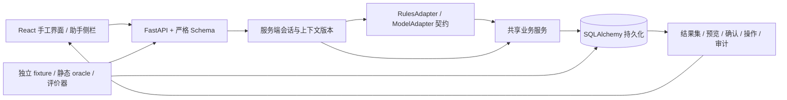

# 首个工程版本架构（2026-10-26 历史记录）

2026-10-27 已增加模型适配器并拆分数据库事务；当前设计以 [工程化记录](engineering_2026-10-27.md) 为准，下面保留首版架构。

`agent.py` 的 ModelAdapter 协议只定义受限结构化解析，当前唯一实现为 RulesAdapter。解析器不读取 oracle、数据库备注或认证 token。业务服务重新验证所有参数与权限。API 输出 JSON；网页由受控 React 组件呈现，没有动态执行模型 HTML/JS 的路径。

`plans` 保存指令、适配器、结构化动作和状态轨迹；`plan_steps` 保存动作参数与真实结果。状态机为 RECEIVED → PLANNED → VALIDATED → RUNNING → SUCCEEDED；澄清/拒绝/失败走对应分支。修改另建绑定 payload 的预览计划，等待确认。取消或执行后保留记录。

SQLite 连接启用外键，SQLAlchemy begin 显式发出 BEGIN IMMEDIATE，使本地读-校验-写序列串行；这是简单的本地可靠性策略，不能作为高并发性能结论。PostgreSQL 路径使用会话行锁、唯一约束和订单版本条件更新；尚未进行 PostgreSQL 实际验收。

请求期间的 DB 事务与确认事务相互独立。apply 再次核验凭证，业务更新、操作返回与审计一起提交；若已提交后客户端丢弃响应，重发同键从 operations 返回第一次结果。导出保存在数据库文本字段，适合当前小规模合成任务；后续可改成有校验的文件/对象存储，但不能让下载链接指向不存在的文件。

参考实现机制：[SQLAlchemy SQLite transaction control](https://docs.sqlalchemy.org/en/20/dialects/sqlite.html)，[FastAPI testing](https://fastapi.tiangolo.com/tutorial/testing/)。本版本使用锁文件中已安装并执行检查的版本，不能从文档示例推断所有后端均已验收。
