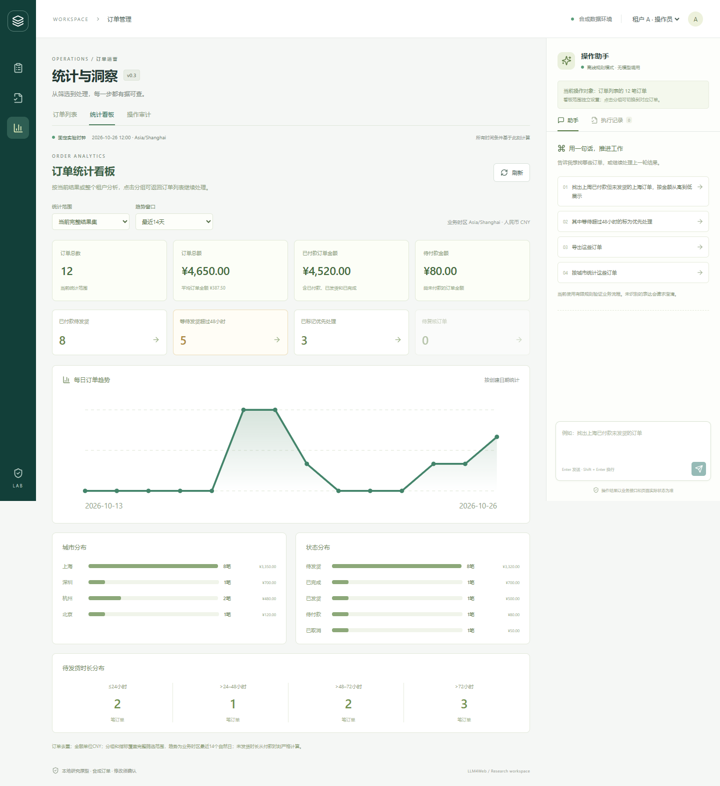

# v0.3 功能验收记录

日期：2026-10-27。功能说明见 [features_v0.3.md](features_v0.3.md)。以下只记录工程功能验收，不是模型效果或用户效率实验结果。

|检查|结果|
|---|---|
|后端完整回归|64 passed、4 skipped，38.53 秒|
|浏览器完整流程|10 passed，30.6 秒|
|原有规则冒烟开发任务|20/20，单独保存原始记录|
|TypeScript / Vite 构建|通过|
|Ruff / API 类型漂移检查|通过|
|Alembic check|模型与迁移一致|
|pip check|无依赖冲突|
|演示库迁移|已升级到 0003，五张业务表摘要相同，1,000 单保留|
|PostgreSQL|4 项因本机未配置数据库而跳过，未声明实测通过|

后端命令：`python -m pytest --basetemp=runtime/pytest-v03-verified`。本轮覆盖高级条件组合、商品条件绑定同一明细、跨租户元数据保护、金额和时长边界、常用查询跨会话保留/更新/私有性/重命名/移除，以及真实审计与分页。

浏览器命令：`npm run test:e2e`。完整日志保存在 `runtime/features-v03-browser.log`。新增流程包括：高级筛选→保存查询→切换工作队列→应用→刷新后恢复；统计范围切换与分组钻取；实际商品/物流详情；备注按文字显示；确认复核后查看审计和订单历史；身份切换清空审计缓存；助手跨页面保持统计范围和指定订单编号。

原有20条规则冒烟任务包含在后端测试中，不能与64个用例相加作为独立任务数。单独运行报告：[report.md](../experiments/runs/20261027T071112Z-385537/report.md)。该运行 manifest 记录了后端、评价器以及前端新增组件的源文件摘要。运行与日志目录为本地忽略产物。

迁移备份为 `runtime/backups/before-0003-e3de6873.db`，迁移前后业务 SHA-256 为 `b5ff4ebb8d7e7c1b52b12ed8a62ce23058a59ef822fd8f079ac280a478d82dc3`。没有重置或重新写入现有演示订单。

截图经过查看；截图使用16单边界 fixture，其中租户 A 有12单，不能把截图数字当成日常演示库的统计结果。

[手机看板](assets/v03-dashboard-mobile.png) · [完整订单详情](assets/v03-order-detail.png) · [操作审计](assets/v03-audit.png)

保留了测试库的 Starlette/httpx 弃用提醒，并在并发测试中观察到一次 Pydantic alias 元数据提醒；没有屏蔽失败，所有已执行用例通过。本轮未启用真实模型或产生付费调用。测试自建的18000服务已停止，未操作8000已有服务；运行中的旧版本需要重启加载新接口。
