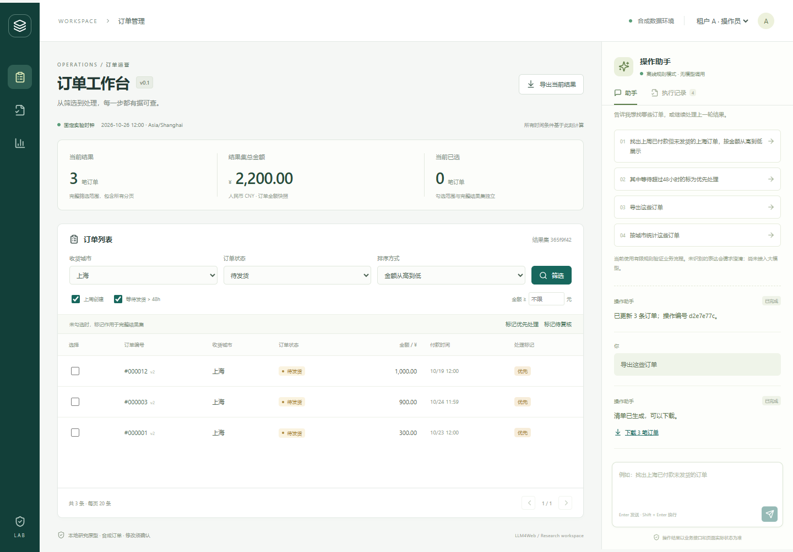

# 工程验收记录 · 2026-10-26

此记录只报告实际运行的本地工程检查，不是研究实验结果。

|检查|结果|证据|
|---|---|---|
|pytest 后端与评价器|26 passed，11.30 秒|`python -m pytest --basetemp=runtime/pytest-acceptance`|
|开发冒烟任务|20/20|[逐任务原始运行](../experiments/runs/20261026T081745Z-f1c514/report.md)|
|前端类型检查与构建|通过|`npm run build`，TypeScript + Vite|
|浏览器端到端|3 passed，9.9 秒|`npm run test:e2e`，本机无头 Microsoft Edge|
|数据库迁移与 ORM 一致性|无差异|Alembic check；pytest 从空库执行真实 migration 并比较 metadata|
|Python 依赖一致性|通过|`pip check` → No broken requirements found|
|演示数据|1,000 订单|固定种子，3 租户、100 客户、50 商品|

26 个 pytest 用例中包含一个执行全部 20 条冒烟任务的用例，两个数量不能相加作为独立任务数。浏览器检查使用独立的 16 单 fixture，不污染演示库。

验证覆盖：周边界与 48 小时边界、稳定排序、Decimal 金额、分页/第二条/勾选绑定、明确集合导出、真实 CSV BOM/内容/校验、缺少确认拒绝、摘要绑定、取消与过期、版本冲突整体回滚、同幂等键并发提交、提交后响应丢失模拟、新进程实例恢复、只读角色、跨租户和跨会话对象访问拒绝、超过 500 条修改拒绝，以及评价器对故意错误终态的识别。

浏览器流程检查手工筛选 → 自然语言查询 → 多轮过滤 → 完整预览 → 刷新恢复 → 页面确认 → 数据版本更新 → 下载并读取真实 CSV；另检查只读拒绝、未知条件澄清、取消、详情、390px 手机布局及页面无水平溢出。截图经过查看，修复了消息类名与侧栏样式冲突。

[手机截图](assets/workbench-mobile.png)

已知工具警告：锁定的 Starlette 对旧 httpx TestClient 发出一次弃用提醒，测试均通过；后续升级测试依赖时统一处理。测试日志没有被屏蔽以隐藏失败。

当前仓库已初始化 Git，工作区未创建提交，因此 manifest 中 code_commit 为 null；另记录完整源文件摘要、适配器/评价器/数据摘要，避免把未提交代码冒充某个提交。运行产物位于本地忽略目录；首次提交后应重新运行并记录提交与工作区状态。

尚未验收：真实模型效果/成本、冻结测试集、B1/B2/B3、Q0/Q1/Q2、PostgreSQL 实机、数据库 RLS/受限 SQL、用户效率实验和训练收益。
