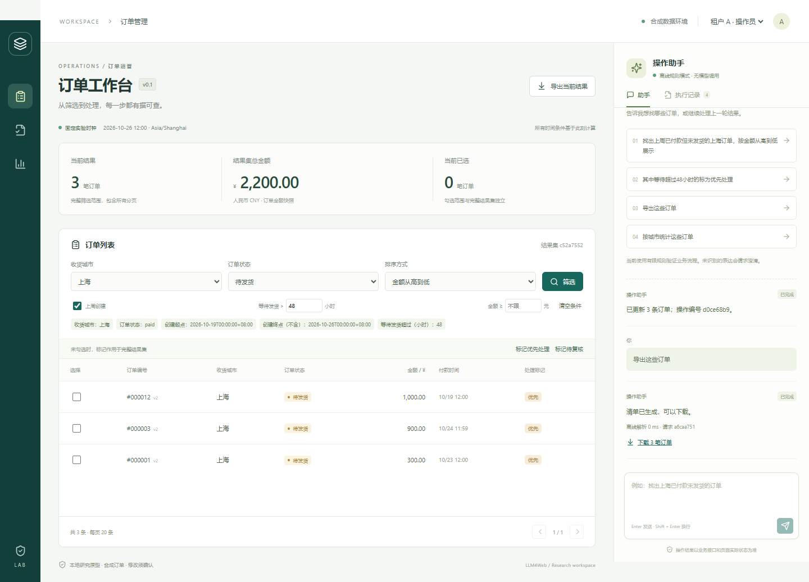

# 工程验收 · 2026-10-27

本轮修改说明见 [engineering_2026-10-27.md](engineering_2026-10-27.md)。下表记录实际执行结果，不把尚未运行的 CI、数据库或真实模型接口计为通过。

|检查|实测结果|
|---|---|
|完整 pytest|48 passed、4 skipped，13.00 秒|
|规则冒烟开发任务|20/20，通过；包含在 pytest 中，另单独生成运行报告|
|浏览器端到端|5 passed，11.3 秒，本机无头 Edge，独立 18000 端口|
|TypeScript / Vite 构建|通过|
|Ruff 静态检查|通过|
|OpenAPI 生成类型漂移检查|通过|
|pip check|无依赖冲突|
|Alembic check|模型与迁移无差异|
|旧演示库升级|五张业务表摘要相同，1,000 条订单保留|
|PostgreSQL 集成|4 项明确跳过：未配置 TEST_DATABASE_URL / 本机未安装数据库|
|Docker 与远端 CI|配置已创建，尚未实际执行|
|真实 OpenAI 网络调用|未执行，适配器使用 MockTransport 验证，无付费调用|

最终后端命令：

```powershell
.\.venv\Scripts\python.exe -m pytest --basetemp=runtime/pytest-final-offline-isolation
```

独立冒烟原始记录：[逐任务报告](../experiments/runs/20261027T024145Z-9b3739/report.md)、[manifest](../experiments/runs/20261027T024145Z-9b3739/manifest.json)、[summary](../experiments/runs/20261027T024145Z-9b3739/summary.json)。日志另存于 `runtime/smoke-events-oct27.log`。这些文件为本地忽略产物，复制项目时需另行保留。

新增检查覆盖：

- 72 小时阈值、金额上限和付款时间条件的前后端往返保留。
- 服务异常不会创建新的操作员身份；未知 Host 无法写入。
- 解析期间独立事务能看到已提交计划并修改上下文；旧结果返回后拒绝执行。
- 非法身份/确认字段、未知工具、超时、429、非法 JSON、未完成模型响应均不修改订单。
- 全局预算不能通过创建新会话重置；失败尝试计入调用次数；禁用模型时无网络请求。
- 调用 token、估算费用、关联 ID 与失败状态持久化；中断记录过期后被识别。
- 旧结构到 0002 的增量迁移保留业务行，fixture-reset 通过真实迁移重建并写入正确版本。
- 评价器能识别订单明细等关联业务表的额外改动。
- 即使环境开启真实模型，规则冒烟任务仍强制离线。

数据库备份：`runtime/backups/before-0002-9a460907.db`。迁移前后业务 SHA-256：`b5ff4ebb8d7e7c1b52b12ed8a62ce23058a59ef822fd8f079ac280a478d82dc3`。备份不是已经完成恢复演练的证明。



[手机截图](assets/workbench-mobile-2026-10-27.png)

仍保留一条 Starlette/httpx TestClient 弃用提醒；未屏蔽失败。Git 工作区尚未创建提交，CI 配置没有被远端执行。测试自建服务已停止，未重启或停止 8000 已有服务；运行中的旧进程需要重启才会加载新的后端代码。
