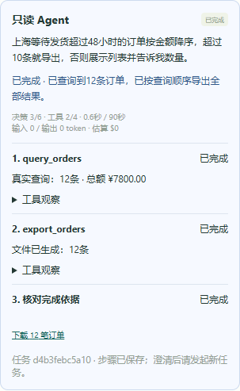

# v0.4只读Agent验收记录

日期：2026-10-28。用户指定真实评测使用后续部署的本地模型，本轮保留空URL、Key、模型名并关闭实际调用。

|检查|结果|
|---|---|
|后端全量回归|170 passed、4 skipped，32.12秒；记录见`runtime/v04-delivery-junit.xml`|
|原有浏览器流程|10 passed，22.0秒|
|新增Agent浏览器流程|4 passed，11.8秒|
|24条Agent循环脚本回归|24/24；49次模拟决策、30次工具调用尝试；真实模型调用0|
|本地协议|Chat Completions / Responses均以MockTransport验证，无真实网络模型请求|
|TypeScript/Vite|构建通过|
|Ruff / API契约|通过|
|Alembic check|模型与迁移一致，无新增差异|
|实际演示库|迁移到0004，保留1000单，五张业务表摘要一致|
|真实模型效果|按用户要求待本地部署后验证；不能用脚本24/24替代|
|PostgreSQL / Docker|本轮没有实机验证；PostgreSQL测试继续明确跳过|

后端测试包括：真实观察进入下一次决策；查询后导出/结束；页面版本变化；会话过期；模型/工具次数、总时间、重复调用预算；非法工具/参数/决策形状；错误完成数量/文件；未知费用预留跨会话生效；已生成文件后任务失败；重复工作器不重放；提交响应异常保留已落盘观察。原有工具回放和条件任务已包含在后端测试数量中，不相加报告为额外模型任务。

评价器反例会让查询返回12条后直接结束而不导出。虽然执行器核验真实数量后可返回SUCCEEDED，独立评价器仍判分支失败；因此没有把聊天文本或执行状态单独作为任务成功依据。

## 可复查证据

- 最终脚本循环报告：[report.md](../experiments/runs/agent-scripted-20261028T034104Z-934bea/report.md)。模式明确为scripted，24/24仅证明循环与工具工程行为。
- 同目录`manifest.json`保存运行前源码、依赖、fixture和标准摘要，`events.jsonl`保存逐步决策与工具观察，`artifacts/`保存独立SQLite库、逐案检查和真实CSV；`summary.csv`统计耗时、调用、Token、费用与失败类别。
- 浏览器日志：`runtime/v04-browser-existing.log`、`runtime/v04-browser-agent.log`。均使用本机独立fixture服务，测试后18000/18001无监听；未启动或重启8000服务。
- 数据库备份：`runtime/backups/before-0004-20261028T032946Z.db`。迁移记录：`runtime/v04-migration.json`。
- 五张业务表迁移前后摘要均为`82ac72f5ac0cb2aa0119c11c66def4575d7689509ef91f31c8b053dd4787f92b`。本次直接从SQLite各表所有列按主键排序序列化，不与历史不同序列化方式的摘要作数值比较。
- `.env`现已创建，模型URL/Key/名称为空、调用关闭，默认规则模式保留；`.env.local-model.example`可供后续本地部署填写。没有记录、发送或生成真实密钥。

## 网页检查

截图使用35单合成fixture和明确的脚本决策测试替身，其中上海严格超过48小时的订单12条；不能当作日常1000单演示库的查询结果或真实模型效果。

截图已检查并修正下载入口与任务编号的排版。浏览器同时验证了真实CSV顺序、恰好10条不导出、澄清/失败状态、刷新恢复步骤、身份切换清除旧任务以及390像素视口布局。

## 限制

真实本地服务尚未部署，兼容接口和模型理解能力待联调。24条是开发任务，静态标准尚未经过独立人员复核。没有自动修复、澄清续跑、持久化工作队列或跨进程任务接管；进程中断只保留状态，原始deadline后停止，不自动重放。

保留原有Starlette/httpx弃用提醒，没有据此更换依赖或屏蔽检查。Docker/PostgreSQL的既有配置未被当成实测通过。
